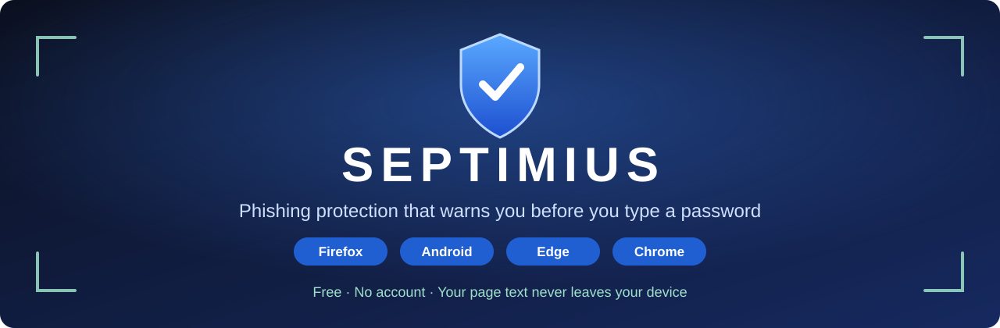

  

  <b>Warns you before you type a password on a fake website.</b> 
  A free browser extension that checks every page you open for the signs of phishing, explains what it found in plain words, and puts a full-page warning in front of known threats.

## Get Septimius

| Browser | Link |
|---|---|
| **Firefox** (desktop and Android) | [Firefox Add-ons](https://addons.mozilla.org/en-US/firefox/addon/septimius-phishing-detector/) |
| **Microsoft Edge** | [Microsoft Edge Add-ons](https://microsoftedge.microsoft.com/addons/detail/septimius-phishing-dete/akilfojebneefelpeeohehpdobgobeod) |
| **Google Chrome** | [Chrome Web Store](https://chromewebstore.google.com/detail/septimius-phishing-detect/fjhdpbdldfggcfkldklaigkiimieccjg) |

## Learn more

- [Homepage](https://isaacelazzabi.github.io/septimius-privacy/home/)
- [Support](https://isaacelazzabi.github.io/septimius-privacy/support/)
- [Privacy policy](https://isaacelazzabi.github.io/septimius-privacy/)

Built by [Isaac Elazzabi](https://ca.linkedin.com/in/isaac-elazzabi), Calgary, Canada.
